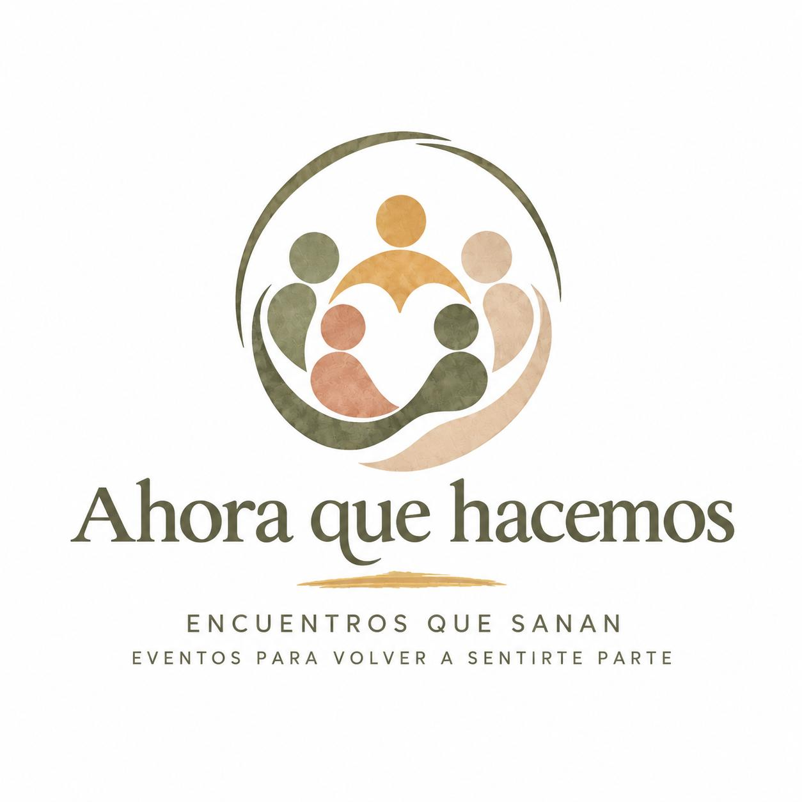

# Ahora que hacemos — brand kit

Version: **0.1.0** · Status: **draft proposal for the first website**

The founder supplied the description and work-in-progress logo below. All
other direction and example copy in this kit is proposed, not approved.
Use it consistently for prototypes; revise it as the identity develops.
Shared conventions: [Site brand kits](../../../docs/brand-kits.md).

## Foundation

Brand name: **Ahora que hacemos**. Preserve this spelling in the brand name;
use normal Spanish accents and punctuation in surrounding prose.

Founder description:

> Conectamos personas a través del yoga, la danza y el movimiento, en contacto
> con la naturaleza, acompañando procesos de cambio y bienestar.

Core idea: **Encontrarnos a través del movimiento y la naturaleza.**

Proposed audience: people seeking connection, shared movement, and space for
wellbeing, including people navigating change. Do not assume their age,
fitness, experience, emotional state, or medical needs.

Personality: cercana, serena, vital, acogedora, con los pies en la tierra.
Make participation feel approachable while leaving people free to choose.
Belonging is an invitation, not a guaranteed result.

## Voice and language

- Default to Spanish, addressing one person as **tú** and speaking as **nosotros**
  when representing the organisers. Use natural, broadly understandable language.
- Prefer short, concrete sentences and active verbs: compartir, movernos,
  respirar, explorar, encontrarnos, acompañar.
- Pair emotional invitations with practical information. Explain what happens
  at an event before asking someone to reserve.
- Use inclusive collective language such as personas, grupo, comunidad, and
  quienes participan. Avoid assumptions about bodies, partners, or families.
- Sound warm without false intimacy. Avoid pet names, pressure, excessive
  exclamation marks, and a constant stream of spiritual metaphors.
- Avoid “transforma tu vida”, “tu mejor versión”, “eleva tu vibración”, and
  claims to cure, heal trauma, or deliver guaranteed emotional outcomes.
- Never invent dates, locations, prices, credentials, accessibility provisions,
  availability, or suitability for beginners. Ask for missing facts or visibly
  mark placeholders in drafts. Do not publish placeholders.

The reference logo says “Encuentros que sanan” and “Eventos para volver a
sentirte parte”. Treat both as provisional logo text. Prefer the core idea
above in new headlines until the founder confirms the tagline. Do not expand
“sanan” into therapeutic promises.

### Writing examples

Prefer: “Te invitamos a compartir una mañana de movimiento y naturaleza.”
Avoid: “¡La experiencia que cambiará tu vida para siempre!”

Prefer: “Consulta cómo será la sesión y qué necesitas llevar.”
Avoid: “No necesitas experiencia” unless the organiser has confirmed it.

Proposed homepage copy:

> **Movimiento, naturaleza y encuentros para compartir.**
>
> Conectamos personas a través del yoga, la danza y el movimiento. Creamos
> espacios de encuentro en contacto con la naturaleza, acompañando procesos
> de cambio y bienestar.
>
> **Descubre los encuentros**

Other useful labels: “Cómo son los encuentros”, “Conoce el proyecto”,
“Ver los detalles”, “Escríbenos”. Use “Reserva tu plaza” only where reservation
is actually available. Empty state: “Estamos preparando nuevos encuentros.
Vuelve pronto para descubrirlos.” Do not imply a mailing list exists.

## Visual identity

The supplied JPEG is a **reference**, not a final production logo. Its circular
figures, open centre, earthy colours, and texture suggest community, movement,
and warmth. Preserve the original here. Do not redraw or regenerate the logo
inside generated images. Obtain an approved vector or transparent master before
final production; a plain text brand name can serve during prototyping.

Exact proposed colours and font stacks live in [tokens.json](tokens.json).
Colours are inspired by the reference, not certified samples of its originals.

- **Paper**: primary page background; **ink**: body text.
- **Olive**: headings, links, primary buttons; paper or white button text.
- **Sand**: quiet section backgrounds; **ochre**: small emphasis and accents.
- **Terracotta** and **sage**: supporting shapes and illustrations.
- Keep accent colours out of small text and critical controls unless contrast
  is verified. Check actual text/background pairs and visible focus states
  during implementation; never communicate meaning through colour alone.

Use the heading serif for warmth and an editorial feel, with the body sans
serif for clarity. These system stacks avoid a font dependency in the first
version and do not claim to reproduce the logo lettering. Use sentence case,
comfortable body sizes, and generous line spacing. Reserve widely spaced
uppercase for occasional short labels.

Layouts should feel open and grounded: generous margins, clear hierarchy,
soft curves, and restrained paper-like texture. Keep text on clean surfaces.
Use one clear primary action per section. Avoid busy backgrounds, ornamental
mandalas everywhere, and decorative motion that competes with reading.

### Photography and illustration

Prefer natural light, believable outdoor settings, human-scale gatherings,
relaxed movement, and a variety of bodies. Show connection without prescribing
how participants must feel. Avoid luxury-retreat clichés, athletic perfection,
forced ecstasy, and unsupported spiritual or cultural symbolism.

For generated illustrations, favour simple organic figures, circular groupings,
olive/sand/ochre accents, and subtle tactile texture. Leave calm space for copy.
Use illustration for imagined scenes; do not present generated people as real
participants or generated locations as confirmed event venues. Use actual event
photography only with appropriate permission.

Example illustration brief:

> Ilustración editorial de un pequeño grupo compartiendo movimiento suave en
> un entorno natural. Formas orgánicas, composición abierta, tonos oliva,
> arena y ocre, textura de papel sutil. Sensación de cercanía y calma con
> vitalidad. Dejar espacio limpio para un titular. Sin texto ni logotipos.

Compose headlines, dates, and approved logos as separate layout elements.

## Website and social applications

The website should introduce the project, explain the experience, show verified
upcoming encounters, and provide a clear way to contact the organisers. Only
show event cards when real details exist. Carry the same palette, typography,
voice, and illustration direction into social templates.

| Destination | Expression |
| --- | --- |
| Website | Calm, clear explanations; practical event details; direct navigation. |
| Instagram | One invitation or idea per graphic; short opening; details in the caption; restrained optional emoji. |
| Facebook | A little more context about the experience, then practical details and a clear action. |
| Meetup | Lead with what the group will do, who the session is intended for, meeting instructions, and preparation, all verified. |

Adapt format and amount of detail without changing the event facts or the
brand personality. Avoid invented urgency and generic hashtag lists. Confirm
current output dimensions when creating assets rather than fixing them here.

## Brief and review

For each campaign supply: purpose, confirmed activity, audience, date/time and
timezone, location, price, organiser, participation requirements, booking link
or contact, destinations, and available approved images. Mark unknown or
inapplicable fields explicitly. The brand kit supplies expression, not facts.

Before accepting a draft, check:

- Does it sound welcoming, concrete, and unhurried?
- Are all factual details traceable to the brief?
- Are wellbeing claims modest and participation requirements accurate?
- Do colour, type, imagery, and copy express the same personality?
- Is text readable on mobile, with useful alt text and sufficient contrast?
- Are the logo status, image provenance, and unresolved placeholders clear?

Next decisions: approve or revise the tagline, finalise logo masters, confirm
audience and geographic language preferences, and review the first real event
page alongside its social graphics. Save approved examples here as they emerge.
